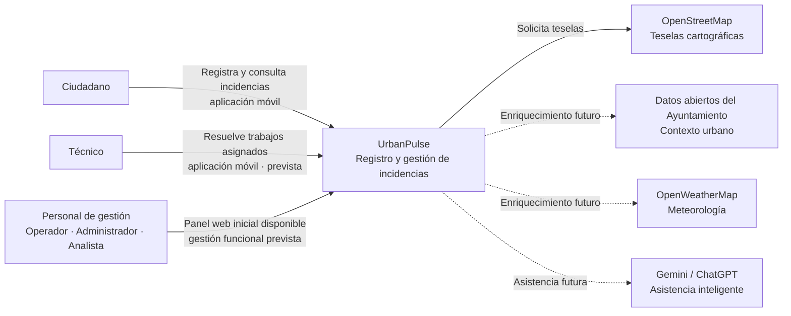
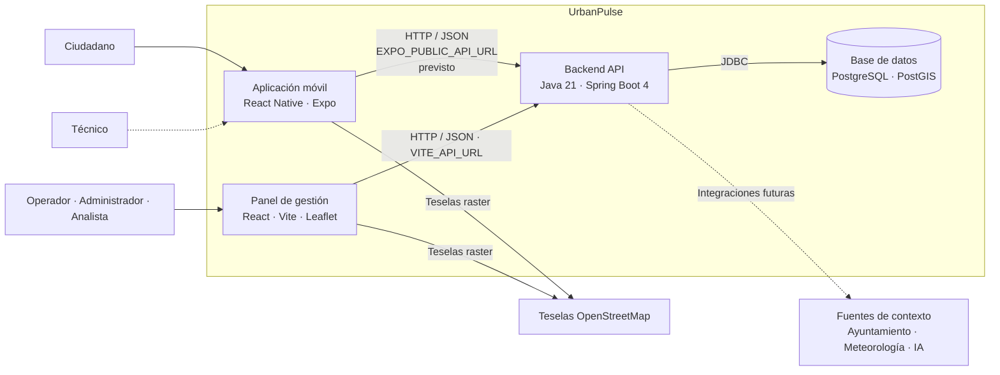
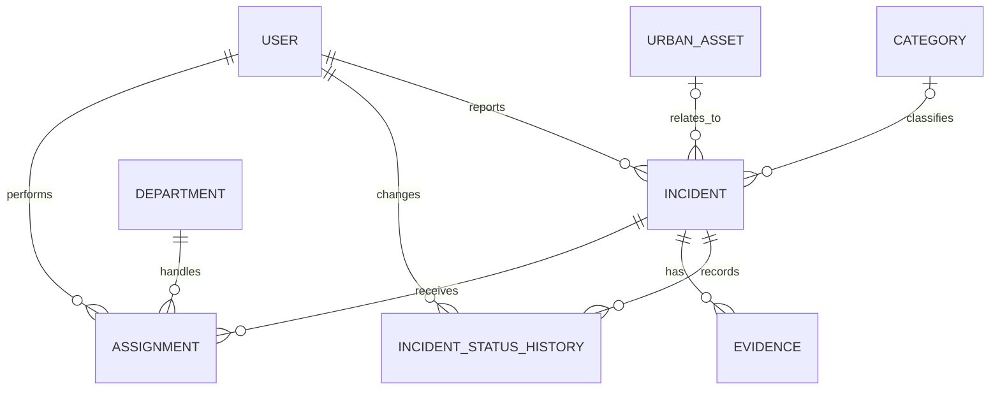

# Arquitectura

Este documento describe la arquitectura de UrbanPulse siguiendo el modelo C4. Distingue los componentes implementados de los previstos según los requisitos y las decisiones de arquitectura registradas en [docs/adr/](adr/).

## Visión general

UrbanPulse es una plataforma para registrar, gestionar y analizar incidencias urbanas en Málaga. Tiene dos clientes: una aplicación móvil React Native con Expo para el ciudadano y el técnico, y un panel de gestión web con React para el operador, el administrador y el analista. Ambos están diseñados para usar un backend monolítico modular con Java 21 y Spring Boot 4, y PostgreSQL con PostGIS. Docker Compose proporciona el entorno local para el backend y la base de datos. Actualmente, la aplicación móvil muestra las incidencias en un mapa, su detalle y un formulario contra una simulación de la API. El panel web ofrece una estructura inicial con navegación y un mapa base de Málaga; los endpoints REST de creación y consulta de incidencias ya están disponibles, aunque todavía no se consumen desde los clientes.

## Nivel 1: Contexto del sistema

El sistema conecta a la ciudadanía y, en fases posteriores, al personal municipal con una plataforma central. El ciudadano y el técnico trabajan en la calle con la aplicación móvil; el operador, el administrador y el analista trabajan desde el panel de gestión web ([ADR-0014](adr/0014-aplicacion-movil-y-panel-de-gestion-web.md)). Los dos clientes muestran cartografía de OpenStreetMap. Las fuentes externas de contexto enriquecerán las incidencias cuando se integren, pero no deberán impedir su registro si no están disponibles.

### Actores

| Actor | Responsabilidades | Cliente |
| --- | --- | --- |
| Ciudadano | Registra incidencias, proporciona su ubicación y consulta su estado. | Aplicación móvil |
| Técnico | Actualiza el progreso y documenta la resolución de los trabajos asignados. | Aplicación móvil |
| Operador municipal | Valida, rechaza, prioriza y asigna incidencias. | Panel de gestión |
| Administrador | Gestiona usuarios, permisos, categorías, departamentos y fuentes externas. | Panel de gestión |
| Analista | Consulta indicadores, patrones territoriales y resultados de análisis. | Panel de gestión |

La aplicación móvil implementada permite al ciudadano ver las incidencias en un mapa de Málaga, consultar su detalle y registrar nuevas. El panel web implementado contiene su navegación inicial y el mapa base de Málaga; los flujos de gestión, seguimiento y trabajo del técnico forman parte del alcance funcional previsto.

### Sistemas externos

| Sistema | Uso | Estado |
| --- | --- | --- |
| OpenStreetMap, mediante teselas de `tile.openstreetmap.de` en móvil y el servicio estándar de teselas en web | Cartografía de la aplicación móvil y del panel de gestión, con atribución a OpenStreetMap | Usado por la aplicación móvil y el panel web |
| Datos abiertos del Ayuntamiento de Málaga | Barrios, distritos, activos urbanos y otros datos de contexto | Previsto para versiones posteriores ([ADR-0008](adr/0008-datos-abiertos-del-ayuntamiento-de-malaga.md)) |
| OpenWeatherMap | Información meteorológica asociada a una incidencia | Aceptado ([ADR-0009](adr/0009-openweathermap-para-meteorologia.md)) |
| Gemini / ChatGPT | Asistencia inteligente y análisis | Aceptado ([ADR-0010](adr/0010-gemini-y-chatgpt-como-ia-principal.md)) |

Los dos clientes deben mostrar la atribución cartográfica correspondiente. Las coordenadas de una incidencia deberán poder obtenerse del GPS o de la selección en el mapa sin depender de que el proveedor de teselas esté disponible ([ADR-0004](adr/0004-openstreetmap-como-fuente-de-mapas.md)).

## Nivel 2: Contenedores

| Contenedor | Tecnología | Responsabilidad y estado |
| --- | --- | --- |
| Aplicación móvil | React Native, Expo, `expo-router`, `react-native-maps`, `expo-location` | Implementa una pantalla de mapa centrada en Málaga, con teselas cargadas mediante `UrlTile`, que muestra un marcador por incidencia y recarga las incidencias cada vez que vuelve a primer plano; una pantalla de detalle de una incidencia con un mapa estático de su localización; y una pantalla de nueva incidencia con un mapa en el que el ciudadano marca la localización, que el GPS propone. Todas las llamadas pasan por `src/api.js`, que todavía simula la API en memoria con unas incidencias de ejemplo. `EXPO_PUBLIC_API_URL` configura el backend para la futura conexión del cliente (#50). |
| Panel de gestión | React, Vite, React Router, `react-leaflet`, CSS propio | Cliente web del operador, el administrador y el analista ([ADR-0015](adr/0015-react-vite-y-leaflet-para-panel-de-gestion.md)). Implementa la estructura inicial, rutas para mapa/listado/detalle y un mapa centrado en Málaga con cuatro incidencias de muestra. La API de incidencias ya está disponible, pero el panel aún no carga ni modifica esos datos; las pantallas de gestión, la agrupación de marcadores y la carga por área visible quedan para siguientes issues. `VITE_API_URL` configura el backend y la capa HTTP compartida está preparada. |
| Backend | Java 21, Spring Boot 4, Maven | Monolito modular. Expone la creación y consulta de incidencias y la consulta de categorías mediante REST; usa las entidades y repositorios JPA de `Incident` y `Category`. |
| Base de datos | PostgreSQL con PostGIS | Docker Compose utiliza `postgis/postgis`. Flyway crea el esquema MVP de `Incident` y `Category`, incluida la ubicación espacial y las categorías iniciales. |

En el entorno local, Docker Compose publica el backend en el puerto `8080` y PostgreSQL en el puerto `5432` por defecto. El backend se conecta a la base de datos mediante el nombre de servicio `db` dentro de la red de Compose. La aplicación móvil se inicia aparte con Expo. Para que un teléfono pueda acceder al backend, `EXPO_PUBLIC_API_URL` debe apuntar a la dirección de red del equipo que ejecuta Docker, no a `localhost`.

Los dos clientes consumen la misma API REST mediante HTTP con JSON; lo que cada uno puede hacer depende de los permisos del rol, no de endpoints distintos por cliente ([ADR-0014](adr/0014-aplicacion-movil-y-panel-de-gestion-web.md)). La aplicación móvil configura la URL con `EXPO_PUBLIC_API_URL` ([ADR-0003](adr/0003-react-native-con-expo-para-frontend.md)) y el panel con `VITE_API_URL`. El backend permite CORS en `/api/**` para el origen configurado en `MANAGEMENT_PANEL_ORIGIN`, cuyo valor local por defecto es `http://localhost:5173`. La API no requiere autenticación en esta entrega.

## Nivel 3: Componentes del backend

El backend se mantiene como un monolito modular. La estructura separa responsabilidades en capas y agrupa el código por funcionalidad, evitando dependencias innecesarias entre módulos ([ADR-0006](adr/0006-arquitectura-monolitica-inicial.md), [ADR-0013](adr/0013-spring-boot-4-para-backend.md)).

| Componente previsto | Responsabilidad |
| --- | --- |
| Controladores REST | Recibir solicitudes HTTP, validar la entrada y devolver respuestas de la API. Implementados para incidencias y categorías. |
| Servicios de aplicación | Coordinar los casos de uso y las transacciones del dominio. Implementados para crear y consultar incidencias y consultar categorías. |
| Repositorios | Consultar y persistir entidades mediante Spring Data JPA. Implementados para `Incident` y `Category`. |
| Entidades y modelo de dominio | Representar incidencias, categorías y las demás entidades del sistema. Implementadas `Incident` y `Category`; las demás se añaden con sus funcionalidades. |
| Migraciones Flyway | Crear y evolucionar el esquema de la base de datos. La migración inicial crea `Incident` y `Category` y precarga las categorías del MVP. Flyway es la única autoridad para modificar el esquema. |
| Integraciones externas | Consultar fuentes de datos urbanos u otros proveedores sin acoplar el dominio a sus formatos. |
| Documentación API | Generar documentación OpenAPI con springdoc-openapi. |

La API implementa los controladores y servicios para el contrato REST del MVP. La persistencia incluye las entidades y repositorios `Incident` y `Category`, además de la migración inicial Flyway.

## API

La API REST disponible en el MVP expone estas rutas:

| Método | Ruta | Descripción |
| --- | --- | --- |
| `POST` | `/api/incidents` | Crear una incidencia con título, descripción, latitud, longitud y categoría opcional. Devuelve la incidencia creada, con estado `REPORTED` (etiqueta visible: «Registrada»). |
| `GET` | `/api/incidents` | Listar todas las incidencias. La paginación queda para una siguiente entrega. |
| `GET` | `/api/incidents/{id}` | Consultar el detalle de una incidencia; devuelve 404 si no existe. |
| `GET` | `/api/categories` | Listar categorías disponibles. |

springdoc-openapi publica las operaciones y modelos en `http://localhost:8080/swagger-ui.html` y `http://localhost:8080/v3/api-docs`.

## Modelo de datos

El modelo completo está descrito en [DBML](data-model/urbanpulse.dbml) y [SQL](data-model/urbanpulse.sql). El [diagrama del esquema MVP](data-model/UrbanPulse-mvp.svg) muestra el subconjunto persistido por la primera migración: `Incident` y `Category`; las demás entidades se incorporarán con las funcionalidades que las necesiten.

| Entidad | Atributos principales previstos | Uso |
| --- | --- | --- |
| `Incident` | Identificador, título, descripción, `category_id`, ubicación, `status_id`, prioridad y fechas de creación y actualización | Incidencia registrada por un ciudadano. Puede tener una categoría, evidencias, asignaciones e historial de cambios. |
| `Category` | Identificador y nombre | Clasificación opcional de una incidencia. El MVP precarga seis categorías. |
| `User` | Identificador, datos de identidad y estado de cuenta | Representa a ciudadanos y personal municipal. |
| `Role` | Identificador y nombre | Define permisos para los distintos tipos de usuario. |
| `IncidentStatusHistory` | Incidencia, estado anterior, estado nuevo, fecha, actor y motivo | Mantiene la trazabilidad del ciclo de vida de una incidencia. |
| `Evidence` | Incidencia, referencia al fichero, tipo, tamaño y fecha de registro | Conserva referencias a fotografías u otros ficheros asociados. |
| `Department` | Identificador y nombre | Representa a las unidades municipales responsables de atender incidencias. |
| `Assignment` | Incidencia, departamento o técnico asignado, fecha y estado | Registra quién debe atender una incidencia validada. |
| `UrbanAsset` | Identificador, tipo, ubicación y datos descriptivos | Representa activos urbanos que podrían asociarse a incidencias próximas. |

La relación entre entidades también es conceptual:

La ubicación se almacena como `geometry(Point, 4326)` en PostGIS, usando WGS 84. La API expondrá las coordenadas como latitud y longitud y el backend se encargará de convertirlas al formato geoespacial de la base de datos ([ADR-0007](adr/0007-postgis-para-datos-geoespaciales.md)). En el MVP, `status_id = 1` representa `REPORTED`; la tabla `Status` se añade cuando se implemente la gestión del ciclo de vida.

La persistencia inicial cubre las entidades asociadas al registro de incidencias y sus categorías. Usuarios, roles, asignaciones, evidencias, activos urbanos e integraciones de contexto se incorporarán cuando se implementen sus requisitos.

## Atributos de calidad

Los siguientes atributos orientan el diseño. Son objetivos arquitectónicos y no garantías de funcionalidades ya implementadas.

| Atributo | Objetivo | Estrategia prevista |
| --- | --- | --- |
| Integridad y trazabilidad | Mantener coherente el ciclo de vida de una incidencia y poder explicar sus cambios. | Gestionar cambios de estado mediante transacciones y conservar actor, fecha y motivo en el historial. |
| Disponibilidad y degradación controlada | Permitir registrar una incidencia aunque una fuente externa no esté disponible. | Tratar los servicios externos como enriquecimiento opcional y aislar sus errores del flujo de registro ([RF26](requirements.md)). |
| Seguridad y privacidad | Proteger datos personales, evidencias y operaciones administrativas. | Incorporar autenticación y permisos por rol; validar tipo y tamaño de los ficheros recibidos. Estas capacidades todavía no están implementadas. |
| Rendimiento | Responder de forma fluida, incluidas las consultas de incidencias próximas y su relación con territorios y activos urbanos, y medirlo frente a una línea base. | Utilizar PostGIS para operaciones espaciales e incorporar índices, también espaciales, cuando las consultas lo requieran ([ADR-0007](adr/0007-postgis-para-datos-geoespaciales.md)). En los mapas, cargar solo las incidencias del área visible y, en el panel de gestión, agrupar los marcadores ([ADR-0015](adr/0015-react-vite-y-leaflet-para-panel-de-gestion.md)). |
| Modificabilidad | Añadir capacidades al dominio sin acoplar toda la aplicación. | Mantener un monolito organizado por funcionalidades, con capas y dependencias claras ([ADR-0006](adr/0006-arquitectura-monolitica-inicial.md)). |
| Desplegabilidad | Reproducir el entorno local y separar la configuración del código. | Usar Docker Compose para backend y base de datos, y configurar puertos y credenciales mediante variables de entorno ([ADR-0012](adr/0012-docker-compose-para-desarrollo-local.md)). |
| Escalabilidad | Seguir siendo fluida con millones de incidencias. | Acotar las consultas (paginación, zona visible) y respaldarlas con índices. El backend se despliega como una única unidad; escalarlo o separar módulos en servicios solo se hará cuando una medición lo justifique, mediante una decisión arquitectónica posterior. |
| Disponibilidad cartográfica | Evitar que la disponibilidad del proveedor de mapas determine la persistencia de una incidencia. | Guardar las coordenadas independientemente de la carga de teselas; la cartografía base es una ayuda visual y tiene atribución visible ([ADR-0004](adr/0004-openstreetmap-como-fuente-de-mapas.md)). |
| Observabilidad | Medir el comportamiento del sistema y comparar los cambios frente a una línea base. | Incorporar métricas, logs centralizados y pruebas de carga (Grafana, Loki y k6). Estas capacidades todavía no están implementadas. |

### Escenarios de calidad

Cada escenario concreta un atributo en un caso medible (estímulo, entorno, respuesta y medida). Todos suponen una base de datos con un millón de incidencias sintéticas. Las medidas que aún no se conocen se fijarán al obtener la línea base con pruebas de carga.

| ID | Atributo | Estímulo | Entorno | Respuesta | Medida |
| --- | --- | --- | --- | --- | --- |
| EC01 | Rendimiento | Un ciudadano abre el mapa de la aplicación móvil. | Un millón de incidencias. | Ve las incidencias de la zona visible, no todas. | Menos de 5 s. |
| EC02 | Rendimiento y escalabilidad | Un operador busca y filtra incidencias. | Un millón de incidencias. | Recibe resultados paginados y ordenados. | Se fijará con la línea base. |
| EC03 | Escalabilidad | Muchos ciudadanos registran incidencias a la vez. | Carga sostenida. | Todas se guardan sin errores. | La concurrencia y el percentil 95 de latencia se fijarán con la línea base. |
| EC04 | Disponibilidad | Un ciudadano registra una incidencia. | Una fuente externa no responde. | Se guarda sin el enriquecimiento ([RF26](requirements.md)). | Ninguna incidencia perdida. |

## Decisiones de arquitectura

Las decisiones que fundamentan esta arquitectura se registran en [docs/adr/](adr/). El índice completo está en [docs/adr/README.md](adr/README.md). Las principales decisiones relacionadas con los componentes descritos son:

- [ADR-0001: PostgreSQL como base de datos](adr/0001-postgresql-como-base-de-datos.md).
- [ADR-0003: React Native con Expo para la aplicación móvil](adr/0003-react-native-con-expo-para-frontend.md).
- [ADR-0004: OpenStreetMap como fuente de cartografía](adr/0004-openstreetmap-como-fuente-de-mapas.md).
- [ADR-0005: react-native-maps como renderizador](adr/0005-react-native-maps-como-renderizador.md).
- [ADR-0006: Arquitectura monolítica inicial](adr/0006-arquitectura-monolitica-inicial.md).
- [ADR-0007: PostGIS para datos geoespaciales](adr/0007-postgis-para-datos-geoespaciales.md).
- [ADR-0012: Docker Compose para desarrollo local](adr/0012-docker-compose-para-desarrollo-local.md).
- [ADR-0013: Spring Boot 4 para el backend](adr/0013-spring-boot-4-para-backend.md).
- [ADR-0014: Aplicación móvil y panel de gestión web](adr/0014-aplicacion-movil-y-panel-de-gestion-web.md).
- [ADR-0015: React con Vite y Leaflet para el panel de gestión](adr/0015-react-vite-y-leaflet-para-panel-de-gestion.md).
